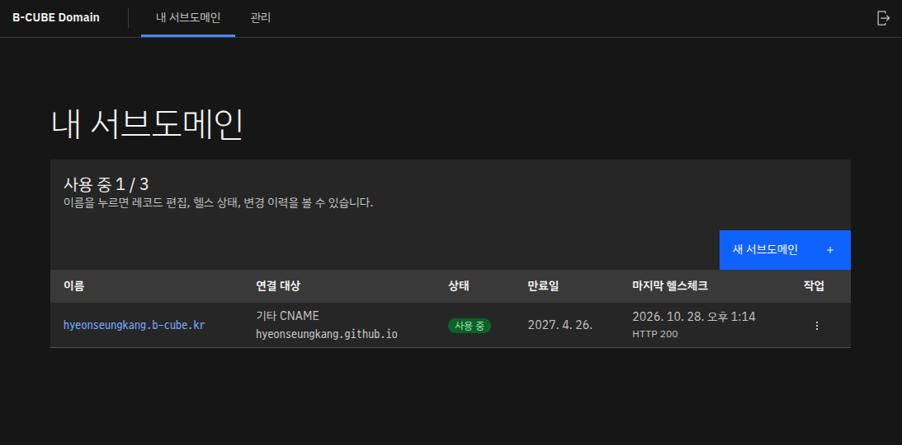
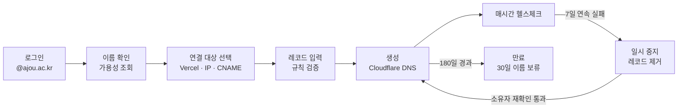
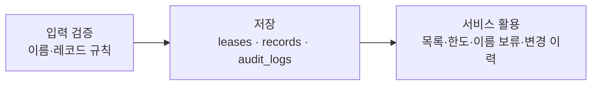
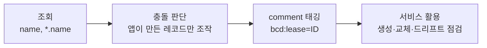
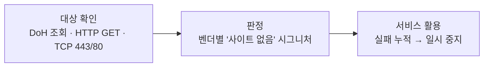
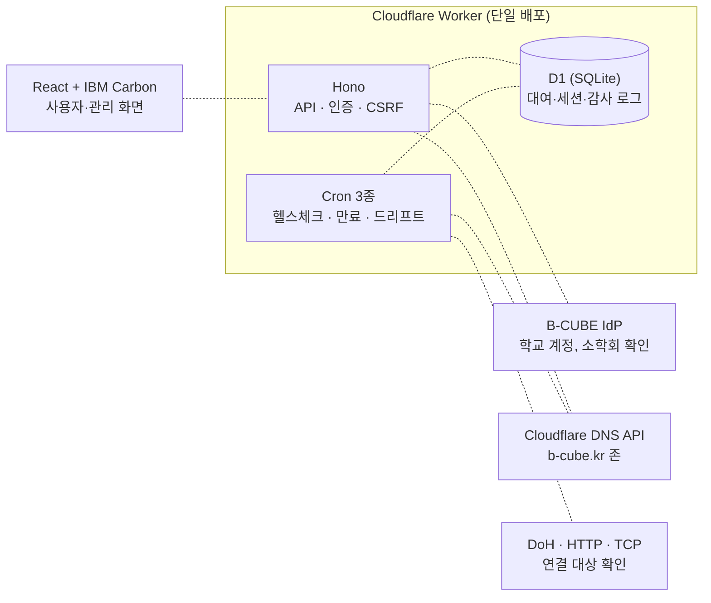

<div align="center">

# B-CUBE Domain Console

### 소학회 공용 도메인(b-cube.kr)의 셀프 대여 서비스



<!-- **{{주최 기관/협의체}}**
**{{대회명}} 출품작**

| 접수번호 | 선정기관 |
|:---:|:---:|
| {{접수번호}} | {{선정기관}} | -->

</div>

---

## 목차

1. [주제 설명](#1-주제-설명)
   - [1.1 제안 배경](#11-제안-배경)
   - [1.2 진단](#12-진단)
2. [서비스 기획](#2-서비스-기획)
   - [2.1 고객 타겟팅](#21-고객-타겟팅)
   - [2.2 서비스](#22-서비스)
   - [2.3 유사서비스 비교](#23-유사서비스-비교)
3. [개발 개요](#3-개발-개요)
   - [3.1 데이터 활용](#31-데이터-활용)
   - [3.2 시스템 구축](#32-시스템-구축)
4. [활용 방안](#4-활용-방안)
   - [4.1 활성화 방안](#41-활성화-방안)
   - [4.2 기대 효과](#42-기대-효과)
- [참고 자료](#참고-자료)

---

# 1. 주제 설명

## 1.1 제안 배경

### 수요 — 학생 개발자의 결과물에는 "자기 주소"가 필요하다

- 소학회 회원은 포트폴리오, 팀 프로젝트, 해커톤 결과물을 Vercel·AWS·Netlify 같은 호스팅에 올린다. 이때 기본으로 받는 주소는 `my-app-x1y2.vercel.app`처럼 호스팅 업체 이름이 붙은 임의 주소다.
- Vercel, Netlify, GitHub Pages는 모두 사용자가 가진 도메인을 연결하는 기능을 제공한다. 하지만 학생이 프로젝트마다 도메인을 사서 갱신하고 DNS를 관리하기는 부담스럽다. 소학회가 이미 가진 `b-cube.kr` 아래 이름(`alice.b-cube.kr`)을 빌려 쓰면 이 부담이 사라지고, 결과물에 소학회 소속도 드러난다.
- 자신의 결과물에 소학회 도메인을 쓰는 일은 곧 "나는 B-CUBE 회원"이라고 밝히는 일이다. 회원은 프로젝트를 공개하고 소개할 때마다 소학회의 일원임을 스스로 확인하고, 같은 주소 아래 모인 다른 회원의 결과물을 보며 함께 활동한다는 감각을 얻는다. 도메인은 기술 자원이면서 **소학회원으로서의 구성원 의식을 높이는 상징**이 된다.

</div>

> **핵심 메시지**
> "회원은 쉽게 빌려 소속을 드러내고, 운영진은 안전하게 돌려받는 소학회 도메인"
> → **셀프서비스 대여 콘솔과 자동 회수 체계** 가 필요

---

## 1.2 진단

콘솔이 없으면 운영진이 Cloudflare 대시보드에서 레코드를 직접 만들고 지워야 한다. 이 수동 방식의 문제를 형식과 행동으로 나눠 본다.

### 형식 진단

<!-- 캡처 필요: Cloudflare 대시보드의 DNS 레코드 목록 화면 → images/diagnosis_form.png -->

- **권한 구조**: 레코드를 만들 수 있는 사람은 존 관리 권한을 가진 운영진뿐이다. 회원에게 권한을 나눠 주면 존 전체(메인 사이트, 메일 레코드 포함)를 건드릴 수 있게 된다.
- **소유 정보 부재**: DNS 레코드에는 "누가, 언제까지, 무엇에 쓰려고" 빌렸는지가 남지 않는다. 시간이 지나면 어떤 레코드를 지워도 되는지 알 수 없다.
- **검증 규칙 부재**: 사설 IP, 다른 회원의 서브도메인을 가리키는 CNAME, `admin`·`mail` 같은 오해를 부르는 이름을 막을 장치가 사람의 주의력뿐이다.
- **기한 부재**: 대여 기간과 만료 개념이 없어 한 번 만든 레코드는 누군가 지우기 전까지 영원히 남는다.

### 행동 진단

<!-- 캡처 필요: 메신저로 레코드 생성을 요청·처리하는 흐름 예시 → images/diagnosis_behavior.png -->

- **수동 대기**: 회원은 메신저로 요청하고 운영진이 처리할 때까지 기다린다. Vercel 검증 TXT처럼 값이 바뀌는 작업은 요청이 여러 번 오간다.
- **기록 없는 변경**: 누가 어떤 값을 바꿨는지 감사 기록이 없어 문제가 생겨도 경위를 추적할 수 없다.
- **방치된 레코드**: 회원이 서비스를 내려도 레코드 삭제를 요청하지 않는다. 운영진은 대상이 살아 있는지 주기적으로 확인할 수단이 없다.
- **사후 대응**: 남용(피싱, 사칭)이 발견돼도 해당 회원의 레코드를 한 번에 찾아 회수하기 어렵다.

> **핵심 메시지**
> 회원이 직접 빌리되, 규칙 검증과 회수는 시스템이 해야 한다.
> → **규칙 기반 셀프서비스 + 헬스체크 기반 자동 일시 중지** 가 필요

---

# 2. 서비스 기획

## 2.1 고객 타겟팅

### 페르소나 A — "내 프로젝트에 소학회 주소를 붙이고 싶은데, 매번 운영진에게 부탁해야 하나요?"

| | |
|---|---|
| <!-- 캡처 필요: 페르소나 A 일러스트 → images/persona_a.png --> | **김하늘(23)**<br>직업: 아주대학교 소프트웨어학과 3학년, B-CUBE 회원<br>소재: 경기 수원 |

**SCENARIO**
취업용 포트폴리오를 Vercel에 배포했고, 팀 프로젝트 API 서버는 AWS EC2에서 돌린다. 둘 다 `b-cube.kr` 주소로 공개하고 싶다. Vercel이 도메인 검증용 TXT 값을 요구해서 운영진에게 두 번째 부탁을 해야 하는 상황이다.

**PAINPOINT**
- 운영진이 답할 때까지 배포를 마무리하지 못한다.
- Vercel이 요구하는 CNAME·TXT 값이 무엇인지, 어디에 넣어야 하는지 헷갈린다.
- 빌린 주소가 언제까지 유효한지, 지금 제대로 연결돼 있는지 알 길이 없다.

**NEEDS**
- 원하는 이름을 바로 확인하고 직접 빌리기 <!-- → 2.2.2 -->
- 연결 대상(Vercel/서버 IP/기타)에 맞는 입력 폼과 연결 가이드 <!-- → 2.2.2 -->
- 내 서브도메인의 상태, 만료일, 변경 이력을 한곳에서 보기 <!-- → 2.2.1, 2.2.3 -->

### 페르소나 B — "누가 어떤 레코드를 만들었는지, 지워도 되는지 어떻게 알죠?"

| | |
|---|---|
| <!-- 캡처 필요: 페르소나 B 일러스트 → images/persona_b.png --> | **이도윤(25)**<br>직업: 아주대학교 4학년, B-CUBE 운영진(도메인 관리 담당)<br>소재: 경기 수원 |

**SCENARIO**
`b-cube.kr` 존의 관리 권한을 가진 운영진이다. 졸업한 회원이 남긴 레코드가 수십 개 쌓여 있지만 주인이 누군지 모른다. 외부에서 "소학회 서브도메인에 이상한 페이지가 뜬다"는 제보를 받았다.

**PAINPOINT**
- 방치된 레코드를 찾아 정리할 근거와 수단이 없다.
- 남용이 발견돼도 해당 회원의 레코드를 한꺼번에 회수하고 기록을 남기기 어렵다.

**NEEDS**
- 주인 없는 서브도메인을 시스템이 찾아 자동으로 일시 중지 <!-- → 2.2.4 -->
- 전체 대여 현황 검색, 강제 회수, 사용자 차단, 감사 로그 조회 <!-- → 2.2.5 -->

---

## 2.2 서비스

### 제안: 규칙 기반 서브도메인 셀프 대여 (`domain.b-cube.kr`)

<!-- 캡처 필요: 내 서브도메인 목록 화면 → images/service_main.png -->

회원은 B-CUBE IdP에서 학교 계정(@ajou.ac.kr)으로 로그인해 1인당 최대 3개의 `<name>.b-cube.kr`을 180일 동안 빌린다. 콘솔은 Cloudflare DNS API로 레코드를 만들고, 매시간 연결 대상을 확인해 주인 없는 주소를 스스로 일시 중지한다.



### 2.2.1 로그인과 내 서브도메인

<!-- 캡처 필요: 로그인 화면, 내 서브도메인 목록 → images/screen_1.png -->

#### 학교 계정 로그인
사용자는 B-CUBE IdP로 로그인한다. 시스템은 ID 토큰을 검증하고 이메일이 `@ajou.ac.kr`이며 인증된 주소인지, B-CUBE 소학회 이력이 있는지 확인한다. 관리자는 소학회 검사를 면제한다. 차단된 사용자는 거부 사유와 함께 로그인 화면으로 돌려보낸다.

#### 상태 한눈에 보기
사용자는 자신이 빌린 서브도메인을 표로 본다. 시스템은 상태(정상·일시 중지·만료)를 색 태그로, 만료일과 마지막 헬스체크 시각을 함께 보여주고, 만료 30일 이내이거나 일시 중지된 항목은 화면 상단에 안내한다. 한도(3개)에 도달하면 "새 서브도메인" 버튼을 비활성화하고 이유를 알려준다.

### 2.2.2 새 서브도메인 만들기 (4단계)

<!-- 캡처 필요: 이름 입력, 연결 대상 선택, 레코드 입력, 확인 단계 → images/screen_2.png -->

#### 이름 즉시 확인
사용자는 원하는 이름을 입력한다. 시스템은 입력이 멈추면(300ms) 형식(3~32자, 소문자·숫자·하이픈), 예약어(`www`, `admin`, `mail` 등 70여 개), 사칭성 금칙어(`google`, `bank` 등)를 검사하고, Cloudflare에 이 앱이 관리하지 않는 같은 이름의 레코드가 있는지 조회해 결과를 입력란 아래에 바로 표시한다.

#### 연결 대상별 입력 폼
사용자는 Vercel / 서버 IP(AWS 등) / 기타 CNAME 중 하나를 고른다. 시스템은 대상에 맞는 폼을 보여준다. Vercel은 CNAME 값이 미리 채워지고 검증 TXT 입력란이 열리며, 서버 IP는 A/AAAA를 타입별 2개까지 받는다. 입력값은 서버와 같은 검증 규칙으로 브라우저에서 먼저 확인한다(사설 IP, IP 형태의 CNAME, `b-cube.kr` 내부를 가리키는 CNAME 거부).

#### 미리보기와 연결 가이드
사용자는 만들어질 레코드를 미리보기로 확인하고 생성한다. 시스템은 Cloudflare에 레코드를 만들고(A/AAAA/CNAME은 Cloudflare 프록시 경유), 대상별 연결 가이드(예: Vercel → Settings → Domains에 주소 추가)를 보여준다.

### 2.2.3 상세 · 편집 · 연장 · 반납

<!-- 캡처 필요: 상세 화면(레코드, 헬스 상태, 변경 이력) → images/screen_3.png -->

#### 레코드 편집
사용자는 생성 때와 같은 폼으로 레코드를 고친다. 시스템은 "새 레코드 생성 → DB 갱신 → 기존 레코드 삭제" 순서로 교체하고, 중간에 실패하면 만든 것을 되돌려 주소가 끊기지 않게 한다.

#### 연장과 반납
사용자는 만료 30일 전부터 연장할 수 있고(180일 추가), 더 쓰지 않으면 이름을 직접 입력해 반납한다. 시스템은 반납 즉시 Cloudflare 레코드를 지운다.

#### 변경 이력
사용자는 이 서브도메인에 대한 생성·편집·헬스체크 실패·일시 중지 이력을 시간순으로 본다. 시스템은 모든 상태 변경을 감사 로그로 남긴다.

### 2.2.4 자동 탈취 방지 (백그라운드)

<!-- 캡처 필요: 일시 중지 안내와 재확인 버튼 → images/screen_4.png -->

#### 매시간 헬스체크
시스템은 매시간 오래 검사하지 않은 서브도메인 10개를 확인한다. CNAME 계열은 대상 이름이 실제로 조회되는지와 서브도메인 응답을 보고, Vercel·Netlify·GitHub Pages의 "연결된 사이트 없음" 응답은 실패로 판정한다. 서버 IP는 443/80 포트 연결을 확인한다.

#### 자동 일시 중지와 재확인
시스템은 하루 1회씩 실패를 세어 7일 연속 실패하면 DNS 레코드를 지우고 일시 중지한다. 이름은 소유자에게 남는다. 사용자는 서비스를 되살린 뒤 "재확인"을 눌러 통과하면 레코드가 다시 만들어진다. 30일 안에 복구하지 않으면 만료된다.

#### 만료와 이름 보류
시스템은 매일 새벽 3시(KST) 만료된 서브도메인의 레코드를 지운다. 만료·반납된 이름은 30일 동안 원래 소유자만 다시 빌릴 수 있고, 강제 회수된 이름은 누구도 빌릴 수 없다. 남이 방금 버린 이름을 가로채 사칭하는 일을 막기 위해서다.

### 2.2.5 관리 화면

<!-- 캡처 필요: 관리 4개 탭 → images/screen_5.png -->

#### 전체 대여와 강제 회수
운영진은 이름·소유자로 전체 대여를 검색하고, 남용이 확인되면 사유를 적어 강제 회수한다. 시스템은 레코드를 지우고 이름을 보류한다.

#### 사용자 차단
운영진은 사유를 적어 사용자를 차단한다. 시스템은 그 사용자의 세션을 모두 끊고 보유한 서브도메인을 한 번에 회수한다.

#### 감사 로그와 드리프트 점검
운영진은 작업자·작업 종류·기간으로 감사 로그를 거른다. DNS를 바꾸는 작업은 모두 작업 기록을 남겨, 중간에 끊긴 작업은 매시간 DB 기준으로 자동 복구된다. 시스템은 매주 Cloudflare 레코드와 DB를 대조해 DB 값으로 되돌릴 수 있는 항목은 자동 복구하고, 앱이 만들었다는 근거가 없는 레코드만 드리프트 탭에 남겨 운영진이 판단하게 한다.

---

## 2.3 유사서비스 비교

| 비교 기준 | **B-CUBE Domain Console** | 도메인 직접 구매 | 공개 무료 서브도메인 서비스 (GitHub PR 신청형) | 호스팅 기본 도메인 (`*.vercel.app` 등) |
|---|---|---|---|---|
| 01 핵심 가치 | **소학회 소속이 드러나는 주소를 무료로, 학교 계정만으로** | 완전한 소유권 | 무료 개인 주소 | 설정 없이 즉시 사용 |
| 02 신청·반영 | **웹 콘솔에서 즉시 생성, 규칙 자동 검증** | 등록·결제·DNS 설정을 직접 | 저장소에 PR → 관리자 검토 후 반영 | 배포 시 자동 |
| 03 방치 레코드 관리 | **헬스체크 7일 실패 시 자동 일시 중지, 180일 만료** | 소유자 책임 | 관리자 수동 정리에 의존 | 해당 없음(호스팅 업체 관리) |
| 04 남용 대응·기록 | **강제 회수, 사용자 차단, 전체 감사 로그** | 해당 없음 | 저장소 커밋 이력 | 해당 없음 |

---

# 3. 개발 개요

## 3.1 데이터 활용

판단에 쓰는 데이터는 내부 DB, Cloudflare DNS API, 외부 상태 확인(DoH·HTTP·TCP) 세 가지다.

| # | 데이터 | 출처 | 용도 |
|:---:|---|---|---|
| ① | 대여·레코드·감사 로그 | 자체 DB (Cloudflare D1) | 소유자·기한·상태 관리, 한도·이름 보류 판단, 변경 이력 |
| ② | 존의 DNS 레코드 | Cloudflare DNS API | 이름 충돌 검사, 레코드 생성·교체·삭제, 주간 드리프트 대조 |
| ③ | 연결 대상 상태 | DoH(`cloudflare-dns.com`), 대상 HTTP 응답, TCP 연결 | 헬스체크 판정, 자동 일시 중지·재활성화 |

### ① 대여·레코드·감사 로그



### ② 존의 DNS 레코드



이 앱이 만든 레코드에는 comment로 대여 ID를 붙인다. 이 태그가 없는 레코드(메인 사이트, 메일 등)는 절대 수정하거나 삭제하지 않는다.

### ③ 연결 대상 상태



```sql
-- 대여와 레코드 (migrations/0001_init.sql 발췌)
CREATE TABLE leases (
  id                TEXT PRIMARY KEY,
  name              TEXT NOT NULL,          -- 'alice' (존 이름 제외)
  owner_email       TEXT NOT NULL REFERENCES users(email),
  target_kind       TEXT NOT NULL,          -- 'vercel' | 'ip' | 'cname'
  status            TEXT NOT NULL,          -- 'active' | 'suspended' | 'expired' | 'revoked' | 'released'
  expires_at        INTEGER NOT NULL,
  health_fail_count INTEGER NOT NULL DEFAULT 0
  -- ...
);
-- 같은 이름은 active/suspended 상태로 하나만 존재
CREATE UNIQUE INDEX uq_leases_name_live ON leases(name) WHERE status IN ('active','suspended');

CREATE TABLE records (
  id           TEXT PRIMARY KEY,
  lease_id     TEXT NOT NULL REFERENCES leases(id),
  cf_record_id TEXT,                        -- 일시 중지 상태에서는 NULL
  type         TEXT NOT NULL,               -- 'A' | 'AAAA' | 'CNAME' | 'TXT'
  host         TEXT NOT NULL,
  content      TEXT NOT NULL,
  proxied      INTEGER NOT NULL DEFAULT 0
  -- ...
);
```

---

## 3.2 시스템 구축

API, 화면, 예약 작업(cron)을 Cloudflare Worker 하나로 운영해 별도 서버가 없다.

### 시스템 아키텍처



| 구성요소 | 기술 | 역할 |
|---|---|---|
| 런타임 | Cloudflare Workers | API, 정적 화면, cron을 하나의 배포 단위로 실행 |
| 백엔드 | Hono, zod | 라우팅, 입력 검증(서버·화면 공용 스키마) |
| RDB | Cloudflare D1 | 사용자, 세션(해시 저장), 대여, 레코드, 감사 로그, 드리프트 결과 |
| DNS | Cloudflare DNS API | 레코드 생성·교체·삭제, comment 태그로 앱 관리 레코드 구분 |
| 인증 | B-CUBE IdP(OIDC, PKCE), jose | ES256 ID 토큰 검증, `@ajou.ac.kr`과 소학회 회원 제한 |
| 프론트엔드 | React, Vite, IBM Carbon | 목록·생성 4단계·상세·관리 4탭, 모바일 폭 지원 |
| 상태 확인 | DoH, `cloudflare:sockets` | 헬스체크(CNAME 대상 조회, HTTP 응답, TCP 443/80) |

#### 보안 설계

`*.b-cube.kr`의 모든 서브도메인은 콘솔과 같은 사이트(same-site)다. 회원이 빌린 서브도메인에서 콘솔을 공격하는 경우를 전제로 설계했다.

- **세션 쿠키**: `__Host-` 접두사로 `Domain` 속성을 막아, 형제 서브도메인이 쿠키를 덮어쓰지 못하게 한다.
- **CSRF**: 상태를 바꾸는 모든 요청에 `Origin` 정확히 일치와 CSRF 토큰 일치를 둘 다 요구한다. SameSite 쿠키만으로는 같은 사이트의 서브도메인 요청을 막을 수 없기 때문이다.
- **권한 격리**: 회원은 자기 대여만 조회할 수 있고, 남의 대여 ID에는 404로 응답해 존재 여부도 숨긴다.
- **검증**: 테스트 6개 파일 269건(규칙 단위 테스트, Workers 런타임 통합 테스트)으로 로그인 허용·거부, CSRF, 한도, Cloudflare 호출 순서와 롤백, 헬스체크·만료를 확인한다.

### 국산 대체재 후보

| 구분 | 현재 사용 | 국산 대체재 후보 |
|---|---|---|
| 서버리스 런타임 | Cloudflare Workers | 네이버클라우드 Cloud Functions |
| 관계형 DB | Cloudflare D1 | 네이버클라우드 Cloud DB for MySQL, NHN Cloud RDS for MySQL |
| 권한 DNS | Cloudflare DNS | 네이버클라우드 Global DNS, NHN Cloud DNS Plus, 가비아 DNS |

<!-- 대체재 제품명은 제출 전에 각 사 공식 페이지에서 현재 명칭을 확인할 것 -->

---

# 4. 활용 방안

## 4.1 활성화 방안

### ① 신규 회원 온보딩에 포함
- 신입 회원 교육의 첫 배포 실습에서 `<이름>.b-cube.kr`을 직접 빌리게 해 사용 경험을 만든다.
- 연결 가이드(Vercel·서버 IP·기타 CNAME)를 실습 자료로 그대로 쓴다.
- 해커톤·프로젝트 발표 때 결과물을 소학회 주소로 공개하도록 권장한다.
- 소학회 홈페이지나 발표 자료에 회원 서브도메인 목록을 소개해, 소학회 주소를 쓰는 일이 회원의 자부심이 되게 한다.

### ② 운영 부담을 시스템으로 이전
- 레코드 요청 창구를 메신저에서 콘솔로 일원화하고, 운영진은 관리 화면의 남용 대응과 주간 드리프트 확인만 맡는다.
- 운영진이 바뀌어도 감사 로그와 대여 기록이 남아 인수인계가 쉽다.
- 예약어·금칙어·한도·대여 기간을 설정값으로 두어 소학회 규모에 맞게 조정한다.

### ③ 다른 소학회·학과로 확장
- 존 이름, 허용 이메일 도메인, 한도를 설정으로 바꾸면 다른 조직의 도메인에도 같은 구조로 적용할 수 있다.
- 운영하면서 쌓이는 벤더별 "사이트 없음" 응답 시그니처를 공유해 탈취 판정 범위를 넓힌다.

<sub>출처: 프로젝트 문서 `docs/SPEC.md`, `docs/LIMITATIONS.md`</sub>

---

## 4.2 기대 효과

1. **회원: 기다림 없이 자기 주소로 결과물을 공개한다.** 운영진 응답을 기다리지 않고 몇 분 안에 서브도메인을 만들고, 상태와 만료일을 직접 관리한다.
2. **회원: 소학회원으로서 구성원 의식이 높아진다.** 자신의 성과물이 `b-cube.kr` 이름으로 공개되면서 회원은 소학회의 일원임을 스스로 드러내고 확인한다. 같은 도메인 아래 쌓이는 동료의 결과물은 함께 성장하는 공동체라는 인식을 만든다.
3. **소학회: 도메인 관리가 사람의 기억에서 시스템의 기록으로 바뀐다.** 모든 레코드에 소유자와 기한이 붙고, 변경은 감사 로그로 남는다.
5. **학교 커뮤니티: 학생 개발 결과물이 학교·소학회 이름으로 축적된다.** 졸업 후에도 남는 포트폴리오 주소가 소학회의 공개 이력이 된다.

### 알려진 한계

- 서버 IP 대상은 포트가 열려 있는지만 본다. 반납된 클라우드 IP가 다른 고객에게 재할당되면 탈취를 감지하지 못한다(토큰 파일 확인 방식 검토 중).
- "사이트 없음" 시그니처는 Vercel·Netlify·GitHub Pages 3종이며 아직 실제 응답으로 확정하지 않았다.
- 7일 연속 실패해야 일시 중지되므로, 그 사이 최대 6일 넘게 탈취 가능한 상태가 남을 수 있다.

---

<div align="center">

## 경청해 주셔서 감사합니다.

**B-CUBE Domain Console**
소학회 공용 도메인의 셀프 대여 서비스

<!-- {{주최 기관/협의체}} · {{대회명}} 출품작
접수번호 {{접수번호}} · 선정기관 {{선정기관}} -->

</div>

---

## 참고 자료

- Mozilla. (n.d.). Subdomain takeovers. MDN Web Docs. https://developer.mozilla.org/en-US/docs/Web/Security/Subdomain_takeovers
- OWASP Foundation. (n.d.). Test for Subdomain Takeover (WSTG-CONF-10). OWASP Web Security Testing Guide. https://owasp.org/www-project-web-security-testing-guide/
- Cloudflare. (n.d.). DNS records API, Proxy status. Cloudflare Docs. https://developers.cloudflare.com/dns/
- Vercel. (n.d.). Adding & configuring a custom domain. Vercel Docs. https://vercel.com/docs/domains
- B-CUBE. (2026). B-CUBE Domain Console 구현 명세(SPEC), 구현 제한점(LIMITATIONS). 프로젝트 저장소 `docs/`.
